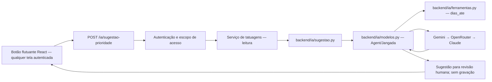

# Arquitetura do backend de IA

## Organização

Todo o código específico da integração com IA fica em `backend/ia/`:

- `__init__.py`: identifica o pacote de IA.
- `modelos.py`: configura Gemini, OpenRouter e Claude pelo Jangada; encadeia Gemini → OpenRouter → Claude com `with_fallback`; executa o Agent e normaliza falhas.
- `ferramentas.py`: define e registra a ferramenta permitida `dias_ate`, que calcula dias corridos sem ler nem alterar dados do sistema.
- `sugestao.py`: mantém a instrução da funcionalidade, prepara os dados sem informações pessoais e solicita a sugestão ao Agent.

## Fluxo da solicitação

A rota aplica as permissões já existentes, lê somente os projetos do escopo autorizado e delega a geração à função do pacote `ia/`. Em caso de falha dos provedores, responde HTTP 503 com mensagem simples. A resposta é apresentada à pessoa usuária e não é persistida; qualquer ação posterior depende da revisão e dos fluxos existentes.

O Agent recebe apenas os campos necessários para a priorização. A ferramenta não consulta banco ou agenda, não grava, não apaga e não envia dados para outros serviços. O acesso externo aos provedores ocorre por meio do Jangada e da cadeia de fallback configurada.

Os testes da integração substituem chamadas externas por mocks e usam dados fictícios. O teste manual do fallback com Gemini inválido limita a cadeia ao OpenRouter para não acionar o Claude pago.
