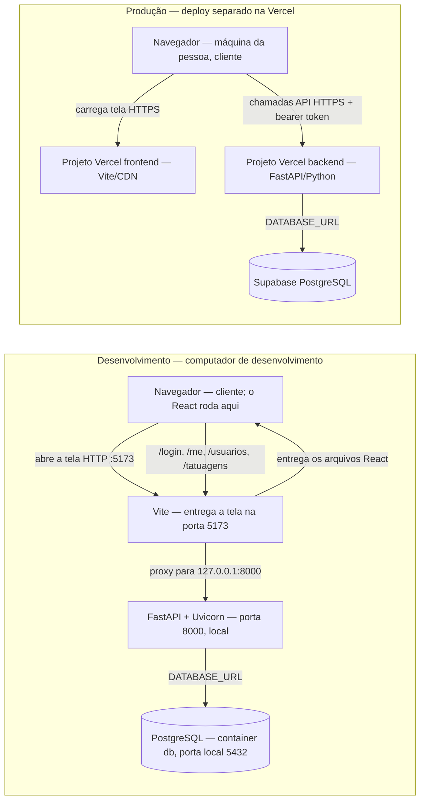

# Infraestrutura

Este desenho separa o desenvolvimento local do deploy de produção preparado para frontend e backend em projetos Vercel separados. Os projetos Vercel e os respectivos domínios ainda precisam ser criados e configurados.

## Plano

No deploy separado, frontend e backend são projetos Vercel com diretórios raiz e domínios próprios. O navegador chama diretamente a API por HTTPS; CORS permite apenas a origem definida em `ENDERECO_FRONTEND`. O Supabase permanece acessível apenas pelo backend através de `DATABASE_URL`; não coloque credenciais do banco no frontend.

## Conferência das caixas

Não encontrei um desenho anterior de infraestrutura da IA no repositório. Conferi as caixas deste plano com o código e com as regras da aula:

| Caixa | Conferência |
| --- | --- |
| Navegador / React | Confirmado: o React executa no navegador da pessoa. |
| Vite | Confirmado no desenvolvimento (`localhost:5173`) e como ferramenta de build do frontend estático para o projeto Vercel. |
| FastAPI + Uvicorn | Confirmado: API local na porta 8000. O proxy do Vite aponta para o loopback. |
| PostgreSQL | Confirmado: o backend conecta por `DATABASE_URL`; o Compose sobe um PostgreSQL persistente e publica a porta 5432 somente em `127.0.0.1`. |
| Vercel | Configuração versionada em `frontend/vercel.json` e entrypoint ASGI `backend/app.py`; cada projeto Vercel ainda precisa ser criado e conectado ao repositório com o respectivo Root Directory. |
| Disco persistente e cópias de segurança | Necessários para preservar o volume PostgreSQL; a rotina de cópias ainda precisa ser definida. |
| CDN, balanceador, réplica de banco e monitoramento | Não aparecem configurados no projeto. Ficaram fora do plano inicial por não haver necessidade ou serviço escolhido que os sustente. |

## Desenvolvimento e produção

| Item | Desenvolvimento | Produção planejada |
| --- | --- | --- |
| Endereço da API | A tela usa rotas relativas; `VITE_URL_DA_API` fica vazio e o Vite encaminha `/login`, `/me`, `/usuarios` e `/tatuagens` para `127.0.0.1:8000`. | Frontend e backend têm domínios HTTPS Vercel separados. `VITE_URL_DA_API` é definido como URL absoluta do backend no build; `ENDERECO_FRONTEND` permite a origem do frontend no CORS do backend. `frontend/.env.production` continua `/api` para o deploy local com Caddy, e deve ser sobrescrito pela variável de build Vercel. |
| Tela | Vite entrega a aplicação; React roda no navegador do computador de desenvolvimento. | Vercel entrega os arquivos Vite pela CDN no projeto frontend. |
| Banco | PostgreSQL local iniciado pelo Compose; `DATABASE_URL` aponta a API para o banco. | Supabase PostgreSQL remoto; a função backend conecta por `DATABASE_URL`. |
| Configuração e segredo | `backend/.env` local fornece `ENDERECO_FRONTEND`, `CHAVE_DO_TOKEN` e `DATABASE_URL`; o arquivo não deve ir ao Git. | Variáveis de backend definidas em Settings do Vercel; o frontend recebe somente a URL pública da API em `VITE_URL_DA_API`. |
| CORS | A API libera a origem exata definida por `ENDERECO_FRONTEND`, se a variável estiver preenchida. | Como os projetos usam origens diferentes, configurar `ENDERECO_FRONTEND` com a origem HTTPS exata do frontend. |

## Uso do Supabase no desenvolvimento

O Supabase substitui o PostgreSQL local como banco remoto; ele não hospeda automaticamente esta API FastAPI. A API e o frontend continuam rodando no computador durante o desenvolvimento, e `DATABASE_URL` em `backend/.env` deve receber a URI PostgreSQL copiada em **Connect** no painel do projeto. A senha permanece somente no arquivo local ignorado pelo Git. A URL do exemplo fica vazia e a aplicação não escolhe silenciosamente `localhost` quando a conexão não está configurada.

Para criar o esquema inicial, executar `python criar_tabelas.py`, `alembic stamp 0001_esquema_inicial` e `alembic upgrade head` dentro de `backend/`. O baseline Alembic marca o esquema instalado pelo script sem recriar nem apagar tabelas; a migration seguinte ativa RLS em `grupos`, `permissoes`, `grupo_permissoes`, `usuarios`, `usuario_grupos`, `tatuagens`, `passos` e `alembic_version`. Sem políticas, os papéis comuns da Data API do Supabase não acessam essas linhas. A API deste projeto conecta como `postgres`, que passa por fora do RLS, e mantém seu controle de acesso. A criação não cadastra perfis de demonstração; os perfis são cadastrados pela API em `/docs`.

## Caminho do login e máquina de cada etapa

1. **Bruna ou Vitor preenche usuário e senha** no navegador do próprio aparelho. O React roda nesse navegador; em desenvolvimento, a pessoa está no computador que também roda os servidores locais.
2. **O navegador envia `POST /login`** como formulário `application/x-www-form-urlencoded`. Em desenvolvimento, a chamada chega ao Vite na porta 5173, que a encaminha ao FastAPI em `127.0.0.1:8000`. Vite e FastAPI rodam no computador de desenvolvimento. Na Vercel, a tela usa `VITE_URL_DA_API` para chamar diretamente o domínio HTTPS independente do backend; o navegador envia a origem do frontend e o backend libera essa origem por CORS.
3. **O FastAPI autentica** na máquina da API. A rota `/login` chama o serviço, que procura e-mail ou username no PostgreSQL e confere o hash da senha. Credenciais inválidas recebem `401`.
4. **O FastAPI assina e devolve um JWT** para o navegador. O token contém o identificador e expira em 60 minutos. O navegador guarda o token em `localStorage` e consulta `GET /me` com `Authorization: Bearer ...`.
5. **O FastAPI valida o token e busca a conta atual** no PostgreSQL. A tela abre a área de cliente ou tatuador conforme o perfil retornado. As chamadas protegidas seguintes também enviam o bearer token; uma resposta `401` apaga os dados locais da sessão.

No deploy Vercel, o navegador continua no aparelho da pessoa e consulta os dois projetos por HTTPS: a CDN do frontend e a função FastAPI. O Caddyfile continua sendo usado apenas no Compose local, onde atende HTTP na porta 80 do contêiner e publica a porta 8080 em `http://localhost:8080`, encaminhando `/api` à API interna.

Referências do fluxo: [formulário e login no React](../frontend/src/Aplicativo.jsx#L1091), [proxy de desenvolvimento](../frontend/vite.config.js#L3), [rota `/login` e `/me`](../backend/rotas/autenticacao.py#L12), [autenticação](../backend/servicos/usuario.py#L25), [consulta PostgreSQL](../backend/repositorios/usuario.py#L36), [JWT e validação](../backend/seguranca.py#L71), [conexão do banco](../backend/banco.py#L22).

## Endereços fixos no código/configuração

- `127.0.0.1`: [frontend/vite.config.js](../frontend/vite.config.js#L5), linhas 5, 9, 13 e 17 — destino do proxy local do Vite para login, identidade, usuários e tatuagens.
- `127.0.0.1`: [.vscode/tasks.json](../.vscode/tasks.json#L7), linha 7 — endereço de escuta da tarefa local que inicia o Uvicorn; é configuração do VS Code.
- `api:8000`: [Caddyfile](../Caddyfile#L5), linha 5 — o Caddy usa o nome de serviço `api` na rede interna do Compose; não é um endereço nem uma porta publicados ao navegador.

`frontend/src/api.js` lê `VITE_URL_DA_API`; em desenvolvimento, a base vazia mantém as chamadas relativas. O Compose usa `/api`; o projeto frontend Vercel deve definir uma URL HTTPS absoluta do backend durante o build. A API também expõe `GET /health`, que retorna `{"status":"ok"}`.

Na validação integrada local com Compose, `GET /` respondeu HTTP 200 e `GET /api/health` retornou `{"status":"ok"}` em `http://localhost:8080`. Os logins e consultas dos dois perfis demonstrativos haviam sido conferidos na execução manual anterior com Caddy. Esse teste local não significa que a proposta HTTPS esteja publicada. Os passos para repetir estão no [README](../README.md#executar-com-docker-compose).

O [Dockerfile do frontend](../frontend/Dockerfile) registra a construção em duas etapas: Node 22 gera o build e a imagem final do Caddy recebe `dist/`. O contexto de build é `frontend/`; o `.dockerignore` local exclui dependências e saídas geradas, mantendo `.env.production` para configurar `/api`. O [Dockerfile do backend](../backend/Dockerfile) constrói a API; o Caddyfile é montado pelo Compose e encaminha à API pelo nome de serviço `api:8000`. O Compose inicia os serviços `web`, `api` e `db`; PostgreSQL armazena os dados em volume persistente e fica acessível pelo nome de serviço dentro da rede. A chave JWT e as credenciais locais do banco ficam no `.env` ignorado pelo Git. A configuração atende HTTP local e não é uma publicação de produção.
