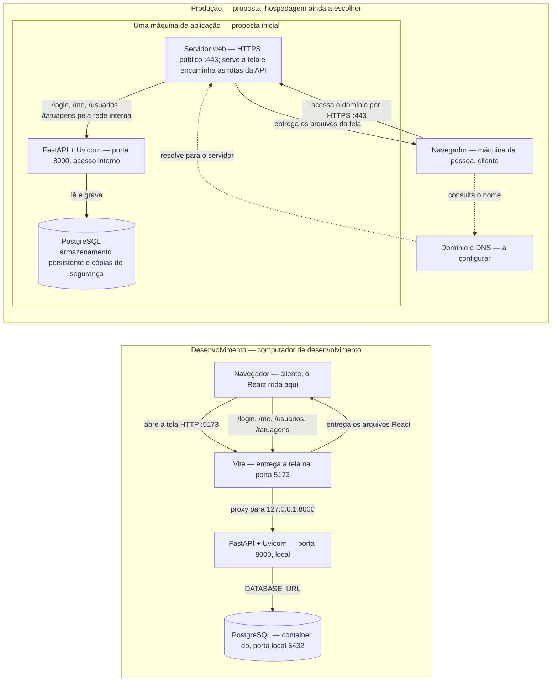

# Infraestrutura

Este desenho separa o que o código já faz localmente do que ainda é uma proposta de produção. Não há provedor, domínio ou servidor de produção configurados neste repositório.

## Plano

Na proposta, só o HTTPS na porta 443 fica público. A API na porta 8000 e o PostgreSQL ficam na infraestrutura de aplicação; a porta 5432 não deve ficar pública. O uso de uma única API evita expor o banco diretamente ao navegador.

## Conferência das caixas

Não encontrei um desenho anterior de infraestrutura da IA no repositório. Conferi as caixas deste plano com o código e com as regras da aula:

| Caixa | Conferência |
| --- | --- |
| Navegador / React | Confirmado: o React executa no navegador da pessoa. |
| Vite | Confirmado apenas no desenvolvimento; o README informa a tela em `localhost:5173`. Não é apresentado como servidor de produção. |
| FastAPI + Uvicorn | Confirmado: API local na porta 8000. O proxy do Vite aponta para o loopback. |
| PostgreSQL | Confirmado: o backend conecta por `DATABASE_URL`; o Compose sobe um PostgreSQL persistente e publica a porta 5432 somente em `127.0.0.1`. |
| Domínio / DNS e servidor web HTTPS | Peças propostas para produção; ainda não configuradas. |
| Disco persistente e cópias de segurança | Necessários para preservar o volume PostgreSQL; a rotina de cópias ainda precisa ser definida. |
| CDN, balanceador, réplica de banco e monitoramento | Não aparecem configurados no projeto. Ficaram fora do plano inicial por não haver necessidade ou serviço escolhido que os sustente. |

## Desenvolvimento e produção

| Item | Desenvolvimento | Produção planejada |
| --- | --- | --- |
| Endereço da API | A tela usa rotas relativas; `VITE_URL_DA_API` fica vazio e o Vite encaminha `/login`, `/me`, `/usuarios` e `/tatuagens` para `127.0.0.1:8000`. | O navegador chama `/api/...` na mesma origem HTTPS. O servidor web remove `/api` e encaminha a rota ao FastAPI interno na porta 8000. `frontend/.env.production` define `VITE_URL_DA_API=/api`. No teste local do Caddy, a tela fica em `http://localhost:8080` e os pedidos da API usam essa mesma origem; o contêiner escuta na 80 e publica a 8080 no computador. Esse teste HTTP não é a configuração pública HTTPS. |
| Tela | Vite entrega a aplicação; React roda no navegador do computador de desenvolvimento. | Servidor web entrega os arquivos da aplicação ao navegador da pessoa. Ainda não há hospedagem configurada. |
| Banco | PostgreSQL local iniciado pelo Compose; `DATABASE_URL` aponta a API para o banco. | PostgreSQL com armazenamento persistente e cópias de segurança. Sem réplica nem várias instâncias da API nesta proposta. |
| Configuração e segredo | `backend/.env` local fornece `ENDERECO_FRONTEND` e `CHAVE_DO_TOKEN`; o `.env` não deve ir ao Git. | Configurações e chave próprias do ambiente, fornecidas ao servidor sem publicar o segredo. Hospedagem e mecanismo de configuração ainda não escolhidos. |
| CORS | A API libera a origem exata definida por `ENDERECO_FRONTEND`, se a variável estiver preenchida. | Se tela e API usarem a mesma origem HTTPS, o navegador não precisa de CORS. Se forem origens diferentes, configurar a origem pública exata em `ENDERECO_FRONTEND`; domínio ainda indefinido. |

## Uso do Supabase no desenvolvimento

O Supabase substitui o PostgreSQL local como banco remoto; ele não hospeda automaticamente esta API FastAPI. A API e o frontend continuam rodando no computador durante o desenvolvimento, e `DATABASE_URL` em `backend/.env` deve receber a URI PostgreSQL copiada em **Connect** no painel do projeto. A senha permanece somente no arquivo local ignorado pelo Git. A URL do exemplo fica vazia e a aplicação não escolhe silenciosamente `localhost` quando a conexão não está configurada.

Para criar o esquema inicial, executar `python criar_tabelas.py` e depois `alembic stamp head` dentro de `backend/`. A criação não cadastra perfis de demonstração; os perfis são cadastrados pela API em `/docs`. O baseline Alembic marca o esquema instalado por esse script, sem recriar nem apagar tabelas.

## Caminho do login e máquina de cada etapa

1. **Bruna ou Vitor preenche usuário e senha** no navegador do próprio aparelho. O React roda nesse navegador; em desenvolvimento, a pessoa está no computador que também roda os servidores locais.
2. **O navegador envia `POST /login`** como formulário `application/x-www-form-urlencoded`. Em desenvolvimento, a chamada chega ao Vite na porta 5173, que a encaminha ao FastAPI em `127.0.0.1:8000`. Vite e FastAPI rodam no computador de desenvolvimento. Em produção, a tela chama `/api/login` na mesma origem, e o servidor web remove o prefixo `/api` antes de encaminhar `/login` ao FastAPI.
3. **O FastAPI autentica** na máquina da API. A rota `/login` chama o serviço, que procura e-mail ou username no PostgreSQL e confere o hash da senha. Credenciais inválidas recebem `401`.
4. **O FastAPI assina e devolve um JWT** para o navegador. O token contém o identificador e expira em 60 minutos. O navegador guarda o token em `localStorage` e consulta `GET /me` com `Authorization: Bearer ...`.
5. **O FastAPI valida o token e busca a conta atual** no PostgreSQL. A tela abre a área de cliente ou tatuador conforme o perfil retornado. As chamadas protegidas seguintes também enviam o bearer token; uma resposta `401` apaga os dados locais da sessão.

Na produção proposta, o navegador continuaria no aparelho da pessoa; DNS e servidor web receberiam o acesso HTTPS, e o proxy encaminharia `/api/...` ao FastAPI interno após remover o prefixo. O Caddyfile copiado da aula atende HTTP na porta 80 dentro do contêiner e publica a porta 8080 localmente em `http://localhost:8080`, sem domínio nem HTTPS; é um teste local, separado da proposta pública HTTPS.

Referências do fluxo: [formulário e login no React](../frontend/src/Aplicativo.jsx#L1091), [proxy de desenvolvimento](../frontend/vite.config.js#L3), [rota `/login` e `/me`](../backend/rotas/autenticacao.py#L12), [autenticação](../backend/servicos/usuario.py#L25), [consulta PostgreSQL](../backend/repositorios/usuario.py#L36), [JWT e validação](../backend/seguranca.py#L71), [conexão do banco](../backend/banco.py#L22).

## Endereços fixos no código/configuração

- `127.0.0.1`: [frontend/vite.config.js](../frontend/vite.config.js#L5), linhas 5, 9, 13 e 17 — destino do proxy local do Vite para login, identidade, usuários e tatuagens.
- `127.0.0.1`: [.vscode/tasks.json](../.vscode/tasks.json#L7), linha 7 — endereço de escuta da tarefa local que inicia o Uvicorn; é configuração do VS Code.
- `api:8000`: [Caddyfile](../Caddyfile#L5), linha 5 — o Caddy usa o nome de serviço `api` na rede interna do Compose; não é um endereço nem uma porta publicados ao navegador.

`frontend/src/api.js` lê `VITE_URL_DA_API`; em desenvolvimento, a base vazia mantém as chamadas relativas, e no build de produção a base é `/api`. A API também expõe `GET /health`, que retorna `{"status":"ok"}`.

Na validação integrada local com Compose, `GET /` respondeu HTTP 200 e `GET /api/health` retornou `{"status":"ok"}` em `http://localhost:8080`. Os logins e consultas dos dois perfis demonstrativos haviam sido conferidos na execução manual anterior com Caddy. Esse teste local não significa que a proposta HTTPS esteja publicada. Os passos para repetir estão no [README](../README.md#executar-com-docker-compose).

O [Dockerfile do frontend](../frontend/Dockerfile) registra a construção em duas etapas: Node 22 gera o build e a imagem final do Caddy recebe `dist/`. O contexto de build é `frontend/`; o `.dockerignore` local exclui dependências e saídas geradas, mantendo `.env.production` para configurar `/api`. O [Dockerfile do backend](../backend/Dockerfile) constrói a API; o Caddyfile é montado pelo Compose e encaminha à API pelo nome de serviço `api:8000`. O Compose inicia os serviços `web`, `api` e `db`; PostgreSQL armazena os dados em volume persistente e fica acessível pelo nome de serviço dentro da rede. A chave JWT e as credenciais locais do banco ficam no `.env` ignorado pelo Git. A configuração atende HTTP local e não é uma publicação de produção.
